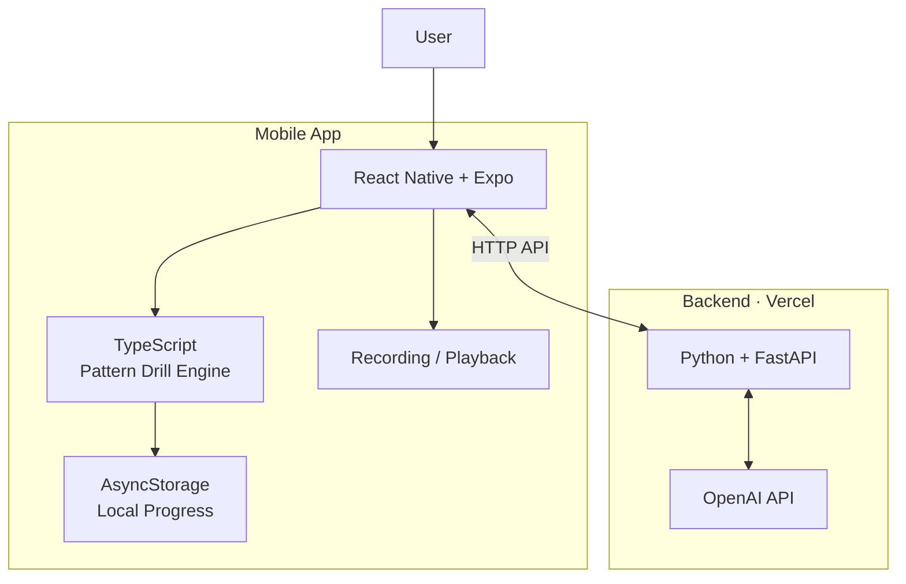

# Convi — Development Roadmap

> **Convi — Turn knowledge into fluency.**  
> Your personal AI language coach. Practice with AI. Speak with confidence.

## Project Goal

Build a mobile-first AI language learning app focused on structured speaking practice.

- Pattern Drills (FSI-style): Build automatic sentence production through substitution, transformation, and expansion exercises.
- Vocabulary in Context: Learn words through examples, collocations, and varied situations.
- Chunk Practice: Internalize reusable expressions and natural phrases.
- Guided Speaking: Progress from complete sentences to speaking with keywords and prompts.
- Scenario-based Speaking: Practise everyday communication, including requests, refusals, opinions, and conversations.
- Free Speaking & Retelling: Develop the ability to tell stories, summarize information, and express opinions independently.
- Review & Retrieval: Reinforce vocabulary, sentence patterns, and recurring mistakes through repeated practice.

The first MVP will implement one complete practice mode: **Pattern Drill**. Users follow predefined exercises, respond verbally, receive AI feedback, and continue to the next exercise.

The initial goal is to build an app that I can use myself every day, rather than a complete multi-user product.

## 1. Technology Stack



## 2. Development Roadmap

### Phase 1 — Validate the Development Environment

**Goal:** Confirm that React Native and Expo work on my computer and physical phone before building the actual application.

- [ ] Install and verify Node.js and npm.
- [ ] Create an Expo project using the official TypeScript template.
- [ ] Start the development server.
- [ ] Install Expo Go on my phone.
- [ ] Connect the phone to the development server using the QR code.
- [ ] Modify the starter screen and confirm that changes appear on the phone.
- [ ] Test basic interactions, such as a button and a text input.
- [ ] Verify that the app can access the internet.

**Completion criteria:**
- The starter app runs on my physical phone.
- I can modify the code and see the result without rebuilding the app.
- I understand the basic development and debugging workflow.

**Do not proceed until this phase works reliably.**

### Phase 2 — Build the Basic Mobile UI

**Goal:** Implement the initial Convi practice screen without connecting AI services.

- [ ] Create the project structure.
- [ ] Implement the practice screen.
- [ ] Add a practice header showing the material and current exercise.
- [ ] Display the target sentence and exercise instructions.
- [ ] Add a microphone button.
- [ ] Add an answer display area.
- [ ] Add an AI feedback card with mock data.
- [ ] Implement Retry and Next Exercise interactions.
- [ ] Test layout and touch interactions on the phone.

The interface should remain minimal. Do not build a sidebar, dashboard, material library management system, or complex statistics yet.

**Completion criteria:** I can complete a simulated practice session from the first exercise to the last.

### Phase 3 — Implement the Pattern Drill Engine

**Goal:** Define the practice rules independently of the UI and AI provider.

- [ ] Define TypeScript types for exercises, answers and feedback.
- [ ] Create a fixed set of approximately 10 exercises.
- [ ] Define the expected answer and acceptable variations for each exercise.
- [ ] Implement exercise progression.
- [ ] Implement retry and completion states.
- [ ] Add basic answer normalization.
- [ ] Separate practice rules from React components.
- [ ] Test the practice logic independently.

Suggested structure:

```text
src/
├── components/
├── features/
│   └── practice/
├── core/
│   ├── types.ts
│   ├── exercises.ts
│   └── practiceEngine.ts
└── App.tsx
```

**Completion criteria:** The entire exercise session works with mock answers, without depending on an AI API.

### Phase 4 — Validate Speech Capabilities

**Goal:** Verify that speech input and audio playback work on a real device.

Investigate available solutions before committing to a speech provider.

- [ ] Test microphone permissions.
- [ ] Record audio on the phone.
- [ ] Play back the recorded audio.
- [ ] Investigate speech-to-text options.
- [ ] Test recognition with my target language.
- [ ] Test recognition with non-native pronunciation.
- [ ] Investigate text-to-speech options for example sentences.
- [ ] Measure recognition latency and evaluate transcription quality.
- [ ] Confirm whether the chosen solution works with Expo Go or requires a development build.

Keep these capabilities separate:

- **Recording:** capture the user's voice.
- **ASR:** convert speech to text.
- **Pronunciation assessment:** evaluate pronunciation, stress or fluency.
- **TTS:** generate spoken examples.

Speech recognition alone does not necessarily provide reliable pronunciation assessment.

**Completion criteria:** I can record an answer, obtain a transcription, and play a spoken example on my phone.

### Phase 5 — Build the Python Backend

**Goal:** Create a minimal backend that securely communicates with AI services.

- [ ] Create a separate backend project.
- [ ] Set up Python and a virtual environment.
- [ ] Install FastAPI, Uvicorn and Pydantic.
- [ ] Create a health-check endpoint.
- [ ] Define request and response schemas.
- [ ] Implement `POST /api/practice`.
- [ ] Integrate the OpenAI Python SDK.
- [ ] Store API keys in environment variables.
- [ ] Validate requests and handle AI errors.
- [ ] Test the endpoints locally.

Example structure:

```text
convi-api/
├── app/
│   ├── main.py
│   ├── schemas.py
│   ├── routes/
│   │   └── practice.py
│   └── services/
│       └── ai_service.py
├── tests/
├── requirements.txt
└── .env.example
```

The backend should initially handle:

1. Receiving the exercise ID and user's transcribed answer.
2. Loading the relevant exercise rules.
3. Calling the AI model with structured instructions.
4. Validating and formatting the feedback.
5. Returning a predictable JSON response.

The AI should evaluate the user's answer within the predefined Pattern Drill rules rather than independently designing the lesson.

**Completion criteria:** A local API request returns valid AI feedback, with no API key exposed to the mobile app.

### Phase 6 — Deploy the Backend to Vercel

**Goal:** Make the API accessible to the mobile app.

- [ ] Configure FastAPI for Vercel deployment.
- [ ] Push the backend to GitHub.
- [ ] Deploy the backend.
- [ ] Configure production environment variables.
- [ ] Test the deployed health-check endpoint.
- [ ] Test the practice endpoint using an API client.
- [ ] Configure error handling and request limits.
- [ ] Verify that the mobile app can reach the deployed API.

Vercel will handle lightweight API requests and AI orchestration. It will not be used to run large speech models or as persistent file storage.

**Completion criteria:** The deployed API can return AI feedback to a remote client.

### Phase 7 — Connect the Mobile App to the Backend

**Goal:** Complete the first end-to-end speaking practice workflow.

- [ ] Add an API client to the mobile app.
- [ ] Connect the answer submission flow to the backend.
- [ ] Replace mock feedback with real AI feedback.
- [ ] Add loading, success and error states.
- [ ] Prevent duplicate submissions while a request is in progress.
- [ ] Support retrying failed requests.
- [ ] Test the complete workflow on the phone.

The initial workflow:

1. Display an exercise.
2. Record the user's response.
3. Transcribe the response.
4. Submit the text to the backend.
5. Display AI feedback.
6. Allow the user to retry or continue.

**Completion criteria:** I can complete a real Pattern Drill session using my voice and receive AI-generated feedback.

### Phase 8 — Save Learning Progress Locally

**Goal:** Make the app usable for daily practice.

- [ ] Save the current exercise.
- [ ] Save completed exercises.
- [ ] Save basic practice history.
- [ ] Restore progress when reopening the app.
- [ ] Handle interrupted or incomplete sessions.

Use local storage initially. A database and user accounts are unnecessary while the app is for personal use on one device.

**Completion criteria:** My progress persists after closing and reopening the app.

### Phase 9 — Test and Improve the MVP

**Goal:** Make the practice experience reliable enough for daily use.

- [ ] Complete several full practice sessions.
- [ ] Evaluate transcription accuracy.
- [ ] Evaluate the quality and consistency of corrections.
- [ ] Measure the time between finishing an answer and receiving feedback.
- [ ] Improve prompt instructions and answer evaluation.
- [ ] Test network failures and API errors.
- [ ] Refine the UI based on actual use.

Prioritize the quality of the learning experience over adding more features.

## 3. Architecture Principles

### Keep business logic separate from UI

The mobile app should contain presentation logic, local state and platform-specific audio interactions.

The practice engine should define exercise progression and expected behavior independently of React components.

The backend should protect API keys, communicate with AI services and enforce server-side rules where appropriate.

### Keep audio processing modular

Initially, use existing speech services instead of running custom speech models.

If more advanced speech processing becomes necessary, deploy it as a separate service. The mobile app and main API should not depend on the implementation details of a specific speech provider.

### Keep infrastructure minimal

Initially:

- No user accounts.
- No database.
- No material upload.
- No multi-mode practice system.
- No custom speech model hosting.
- No web application.
- No monorepo.

Add infrastructure only when a concrete product requirement justifies it.

## 4. Future Improvements

After the MVP is usable and the core experience is validated, consider:

- Importing textbooks, transcripts and other learning materials.
- Adding Vocabulary in Context and Guided Conversation modes.
- More advanced pronunciation assessment.
- Cloud synchronization and user accounts.
- A web version.
- A shared package for business logic and types.
- More advanced learning analytics.

## 5. Definition of MVP Complete

The first MVP is complete when I can:

- Open Convi on my phone.
- Start a predefined Pattern Drill session.
- Hear or read the exercise instructions.
- Answer using my voice.
- Receive a transcription and useful AI feedback.
- Retry or continue to the next exercise.
- Finish a complete practice session.
- Close the app and retain my progress.

**The immediate next step is Phase 1: validate Expo on a physical phone. Do not build the backend or the full application until the development environment is working.**