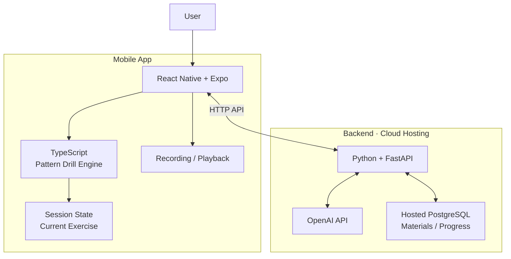

# Convi — Development Roadmap

> **Convi — Turn knowledge into fluency.**  
> Your personal AI language coach. Practice with AI. Speak with confidence.

## Project Goal

Build a mobile-first AI language learning app focused on practical speaking development through three modes:

- **Structured Speaking Drills:** Build automatic sentence production with patterns and reusable expressions. Start with substitution drills; add transformation and expansion later.
- **Vocabulary & Phrase Practice:** Improve active recall, collocations, and the ability to use useful words and phrases in context.
- **Guided Scenario Conversation:** Practice multi-turn speaking in formal and informal situations, such as meetings, presentations, daily conversations, and parties.

Review and retrieval should support all three modes rather than form a separate mode.

The first MVP will implement one activity variant: **Substitution Drill**, within Structured Speaking Drills. Users follow predefined exercises, respond verbally, receive AI feedback, and continue to the next exercise.

The initial goal is to build an app that I can use myself every day, rather than a complete multi-user product.

See [Database Schema Proposal](docs/database-schema.md) for the planned content types, practice modes, and data relationships.

## 1. Technology Stack



## 2. Development Roadmap

### Phase 1 — Build the Backend API and Cloud Database

**Goal:** Provide an API and persistent data for the mobile app, with AI calls protected by the backend.

- [ ] Create a separate backend project and Python virtual environment.
- [ ] Install FastAPI, Uvicorn and Pydantic.
- [ ] Choose a hosted PostgreSQL provider and create a development database.
- [ ] Configure the local backend to connect to the development database.
- [ ] Define records for learning content, its practice mode and method, generated exercise sets, and progress.
- [ ] Create a health-check endpoint and API request/response schemas.
- [ ] Add endpoints to list and retrieve learning content by practice mode, method and CEFR level.
- [ ] Add endpoints to read and update basic learning progress.
- [ ] Add an endpoint that generates a batch of exercises for a practice activity through OpenAI.
- [ ] Store generated exercise sets so the app can serve exercises one at a time.
- [ ] Keep API keys in backend environment variables.
- [ ] Validate requests and handle database and AI errors.
- [ ] Test the endpoints locally against the cloud development database.

The backend provides data, persists progress and makes protected AI calls. The mobile app controls the session flow: which exercise is current, when to retry and when to move forward.

The first API version should support:

1. Listing learning content by practice mode, method and CEFR level.
2. Fetching or generating a stored exercise batch for a content item.
3. Reading and saving basic progress, such as completed exercises and timestamps.
4. Calling OpenAI without exposing its API key to the mobile app.

Example structure (to be refined during implementation):

```text
backend/
├── app/
│   ├── main.py
│   ├── routes/
│   │   ├── content.py
│   │   ├── exercise_sets.py
│   │   └── progress.py
│   ├── schemas/
│   ├── models/
│   ├── services/
│   │   └── ai_service.py
│   └── database.py
├── tests/
├── pyproject.toml
└── .env.example
```

**Completion criteria:** The local backend can read and write the cloud development database, return predictable JSON and generate an exercise batch without exposing secrets to the mobile app.

### Phase 2 — Build the Basic Mobile UI and Practice Flow

**Goal:** Implement the initial Convi practice screen and session interactions.

- [ ] Create the mobile project structure.
- [ ] Implement the practice screen with a material and exercise header.
- [ ] Display the target sentence and exercise instructions.
- [ ] Add a placeholder answer area and feedback card with mock data.
- [ ] Implement Retry and Next Exercise interactions.
- [ ] Keep current-session state in the mobile app.
- [ ] Test layout and touch interactions on the phone.

Keep the interface minimal. Do not build a dashboard, material management system or complex statistics yet.

**Completion criteria:** I can complete a simulated practice session from the first exercise to the last.

### Phase 3 — Implement the Pattern Drill Engine

**Goal:** Define exercise progression independently of the UI and backend.

- [ ] Define TypeScript types for patterns, exercises and session state.
- [ ] Model multiple patterns with approximately five exercises per pattern.
- [ ] Implement next exercise, next pattern, retry and completion states.
- [ ] Separate practice rules from React components.
- [ ] Verify the practice logic independently.

Suggested structure:

```text
src/
├── components/
├── features/
│   └── practice/
├── core/
│   ├── types.ts
│   └── practiceEngine.ts
└── App.tsx
```

**Completion criteria:** A session can progress through multiple patterns using mock data, without the backend deciding which exercise is next.

### Phase 4 — Prepare Default Materials and Connect the Mobile App

**Goal:** Make the app useful immediately with a small curated set of Pattern Drills.

- [ ] Prepare a small set of default content items for structured drills.
- [ ] Review patterns and example exercises before importing them.
- [ ] Add approved content and generated exercise sets to the development database.
- [ ] Add an API client to the mobile app.
- [ ] Load content by practice mode, method and CEFR level through the API.
- [ ] Load an exercise batch and show its exercises one at a time.
- [ ] Save basic progress through the API.
- [ ] Add loading, success and error states.
- [ ] Test the text-based practice flow on the phone.

Default material preparation can be a one-time manual process for now. Automated extraction, file upload and material management are later features. Keep source and license notes with material records where available.

**Completion criteria:** A user can choose a default pattern, complete its exercises one at a time and retain basic progress after reopening the app.

### Phase 5 — Deploy the Backend

**Goal:** Make the API accessible to the mobile app over the internet.

- [ ] Choose and configure a backend host.
- [ ] Deploy the FastAPI backend.
- [ ] Configure hosted environment variables and the production database.
- [ ] Keep development and production databases separate.
- [ ] Verify health, data and AI endpoints remotely.
- [ ] Configure request limits and error handling.
- [ ] Point the mobile app to the deployed API.

Never put database credentials or the OpenAI API key in the mobile app.

**Completion criteria:** The mobile app can use the deployed API and its connected database.

### Phase 6 — Validate Speech Capabilities and Add Voice Practice

**Goal:** Add spoken answers after the text-based practice flow works end to end.

- [ ] Test microphone permissions, recording and playback on a real device.
- [ ] Investigate speech-to-text options and test recognition quality.
- [ ] Investigate text-to-speech for example sentences.
- [ ] Confirm whether the chosen solution works with Expo Go or requires a development build.
- [ ] Connect speech transcription to the practice UI.
- [ ] Add AI answer feedback through the backend.
- [ ] Add retry and network error handling.

Keep recording, speech-to-text (ASR), pronunciation assessment and text-to-speech (TTS) as separate capabilities. Speech recognition alone does not necessarily provide reliable pronunciation assessment.

**Completion criteria:** I can complete a Pattern Drill session using my voice and receive useful AI feedback.

### Phase 7 — Improve the MVP

**Goal:** Make the practice experience reliable enough for daily use.

- [ ] Complete several full practice sessions.
- [ ] Evaluate transcription accuracy and feedback quality.
- [ ] Measure the time between finishing an answer and receiving feedback.
- [ ] Improve prompts and answer evaluation.
- [ ] Test network failures and API errors.
- [ ] Refine the UI based on actual use.

Prioritize the quality of the learning experience over adding more features.

## 3. Architecture Principles

### Keep business logic separate from UI

The mobile app should contain presentation logic, the Pattern Drill session flow, current-session state and platform-specific audio interactions.

The practice engine should define exercise progression and expected behavior independently of React components. The backend provides data, persists progress and communicates with AI services; it does not decide which exercise the user sees next.

The backend should protect API keys, communicate with AI services and enforce server-side rules where appropriate.

### Keep audio processing modular

Initially, use existing speech services instead of running custom speech models.

If more advanced speech processing becomes necessary, deploy it as a separate service. The mobile app and main API should not depend on the implementation details of a specific speech provider.

### Keep infrastructure minimal

Initially:

- Use hosted PostgreSQL for development and keep production data separate.
- Prepare a small curated set of default materials and load them into the database.
- Do not build automated material extraction or upload yet.
- Do not build user accounts until synchronization across users or devices requires them.
- No multi-mode practice system.
- No custom speech model hosting.
- No web application.

Add infrastructure only when a concrete product requirement justifies it.

## 4. Future Improvements

After the core practice experience is usable, consider:

- Letting users add, edit and organize their own learning materials.
- Automating material extraction and import.
- Adding Vocabulary & Phrase Practice and Guided Scenario Conversation modes.
- More advanced pronunciation assessment.
- Cloud synchronization and user accounts.
- A web version.
- A shared package for business logic and types.
- More advanced learning analytics.

## 5. Definition of MVP Complete

The first MVP is complete when I can:

- Open Convi on my phone.
- Start a predefined Pattern Drill session.
- Hear or read the exercise instructions.
- Answer using my voice.
- Receive a transcription and useful AI feedback.
- Retry or continue to the next exercise.
- Finish a complete practice session.
- Close the app and retain my progress.

**The immediate next milestone is the FastAPI API and hosted PostgreSQL development database, followed by the mobile practice flow. Framework setup and device testing are implementation prerequisites, not roadmap phases.**
