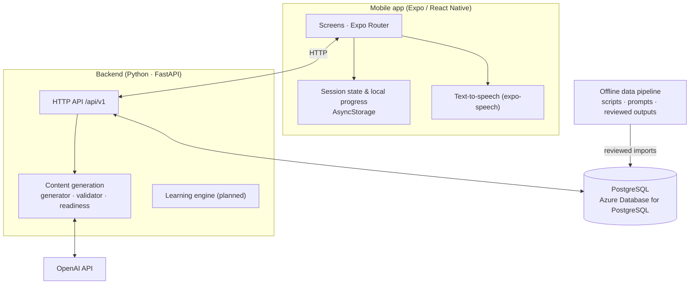
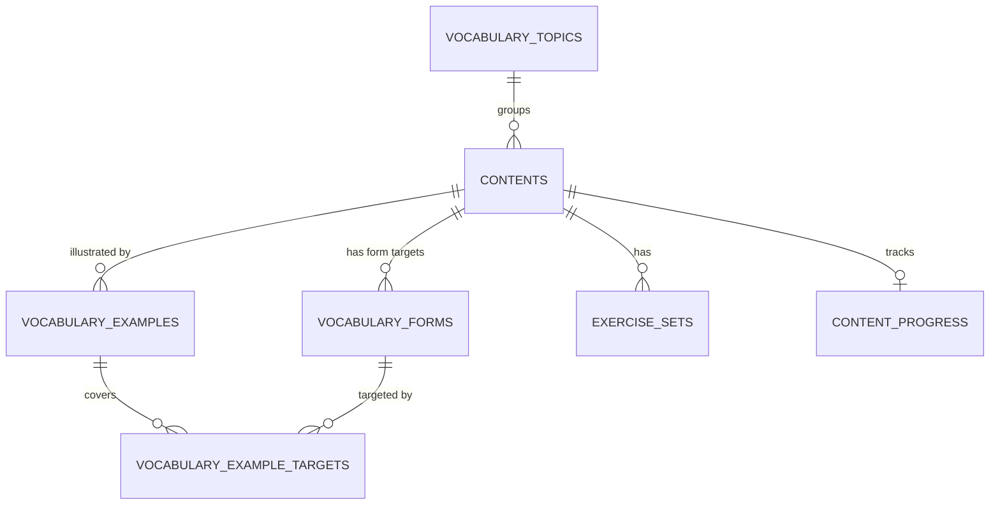
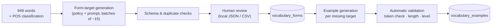

# Convi

> **Turn knowledge into fluency.**
> Your personal AI language coach — practice with AI, speak with confidence.

Convi is a personal AI language-learning app that helps learners turn **passive knowledge** (words and grammar they recognise) into **active speaking ability** (sentences they can produce quickly and naturally).

It started from a real need: learning Finnish while living in Finland and improving spoken English. The first target language is **Finnish**, whose rich morphology makes it a demanding test case for AI-generated learning content.

---

## Why Convi?

Most learning tools focus on recognition: reading, listening, memorising word lists. But understanding a sentence is not the same as being able to say it in a conversation.

Convi is built around a few principles:

- **Knowledge is not fluency.** The app prioritises active production over passive recognition.
- **Patterns beat isolated words.** Words are learned inside reusable sentence patterns.
- **Repetition builds automaticity.** The goal is to produce a sentence with little conscious effort, not just answer correctly once.
- **Context matters.** Short, natural, everyday sentences in realistic situations.
- **Structured practice before free conversation.** AI supports a guided progression instead of acting as an open-ended chatbot.

### Learning method: FSI-inspired pattern drills

The core method is inspired by the Foreign Service Institute's drill-based training:

| Drill | What the learner does | Example |
| --- | --- | --- |
| Substitution | Swap one element, keep the pattern | *Minä asun Helsingissä.* → (Turku) → *Minä asun Turussa.* |
| Transformation | Apply a grammatical change | *Minä asun Helsingissä.* → negative → *En asu Helsingissä.* |
| Expansion | Grow a sentence step by step | *I work.* → *I work in Finland.* → *…as a developer.* |
| Guided production | Build a sentence from a situation and required words | "Explain why you are late: bus, yesterday, problem" |
| Free production | Answer or describe freely, with AI feedback | Open question |

For Finnish, substitution is not a simple word swap: the replacement often needs a different case or ending (*Helsinki → Helsingissä, Turku → Turussa*). This is why Convi models **grammatical forms** explicitly rather than treating vocabulary as word-to-translation pairs.

More detail: [Project context and methodology](docs/PROJECT_CONTEXT.md).

---

## What works today

| Area | Status |
| --- | --- |
| **Vocabulary base** | 949 frequency-based Finnish words in 41 semantic topics, stored in PostgreSQL |
| **Part-of-speech classification** | All 949 words classified (POS, subtype, verb type) |
| **Word-form targets** | First three topics (93 words) have reviewed form targets; v1 generation policy and a 20-word pilot are complete; batch generation is next |
| **AI example sentences** | Short Finnish sentences generated per form target, with a natural **spoken** (puhekieli) version, a **standard written** version and an English translation; automatically validated, deduplicated and saved with provenance |
| **Backend API** | FastAPI service for topics, vocabulary with nested forms and examples, and protected example generation |
| **Mobile app** | Expo / React Native app: topic browsing, example-sentence sessions with Finnish text-to-speech, translation reveal, and locally saved progress |
| **Pattern drill engine** | Designed; an English substitution-drill prototype exists as a script; the mobile drill screen is a placeholder |

The up-to-date, detailed status is kept in **[docs/STATUS.md](docs/STATUS.md)**.

### Mobile app flow

1. **Home** — continue the current topic or start the suggested next one.
2. **Learn** — browse the 41 vocabulary topics with word counts.
3. **Session** — step through words; each form target shows its example sentences, which can be played aloud in Finnish and translated on demand. The position is saved, so a session can be resumed.
4. **Progress** — completed topics and session counts.

---

## Architecture



Key design decisions:

- **Backend owns AI and data.** The mobile app never holds API keys or talks to the database directly.
- **Content and learning logic are separate.** Vocabulary, forms, examples and exercises are reusable content; the frontend contains no core learning logic.
- **Generate once, reuse.** AI content is validated, stored and reused instead of regenerated per session.
- **Validate before import.** Bulk AI output is saved locally, checked and reviewed before it reaches PostgreSQL.
- **Text first, audio later.** The learning mechanism is validated in text before speech recognition is added.

### Tech stack

| Layer | Technology |
| --- | --- |
| Mobile | React Native, Expo SDK 58, Expo Router, TypeScript |
| Backend | Python 3.11+, FastAPI, Pydantic, SQLAlchemy 2, Alembic |
| Database | PostgreSQL on Azure (Microsoft Entra or password authentication) |
| AI | OpenAI Responses API with strict JSON-schema structured output |
| Tooling | uv / pip, ESLint, TypeScript compiler |

---

## Content data model



- `contents` holds every learnable item (currently vocabulary), with its practice mode and method.
- `vocabulary_forms` stores the grammatical forms and usage patterns worth learning for each word (e.g. *talo → talon, taloa, talossa*).
- `vocabulary_examples` stores generated sentences with model, prompt version and validation status.
- `vocabulary_example_targets` links one sentence to the form(s) it teaches, so coverage can be measured per form.

Full description: [docs/database-schema.md](docs/database-schema.md).

---

## AI content pipeline



Quality is treated as a first-class concern:

- Structured output via strict JSON schemas.
- Form selection follows a documented, part-of-speech-specific policy (no fixed quotas, no invented forms).
- Deterministic validation (target form present, sentence length, CEFR level) plus a review status for cases that need a human, such as case government.
- Provenance on every generated row (model, prompt version, source).
- Idempotent import scripts.

Details: [form-target generation checkpoint](docs/data-generation/FORM_TARGET_GENERATION_CHECKPOINT.md) · [generation policy](docs/data-generation/form-generation-policy.md) · [label policy](docs/data-generation/grammatical-label-policy.md).

---

## Repository structure

```text
Convi/
├── README.md
├── docs/                       # Project documentation (index: docs/README.md)
│   ├── PROJECT_CONTEXT.md      # Vision, methodology, decisions, roadmap
│   ├── STATUS.md               # Current status and next steps
│   ├── database-schema.md
│   └── data-generation/        # Generation policies, checkpoint, legacy sources
├── backend/
│   ├── app/                    # FastAPI app, models, services
│   ├── migrations/             # Alembic migrations
│   ├── scripts/                # Import, export and generation scripts
│   ├── data-generation/        # Datasets, prompts and generated outputs
│   └── tests/
└── mobile/                     # Expo / React Native app
    └── src/{app, api, state, ui, utils}
```

---

## Getting started

### Backend

```bash
cd backend
python -m venv .venv && source .venv/bin/activate
python -m pip install -e .
cp .env.example .env        # set database connection and API keys
alembic upgrade head
fastapi dev app/main.py
```

Database setup and API endpoints: [backend/README.md](backend/README.md). Data scripts: [backend/scripts/README.md](backend/scripts/README.md).

### Mobile

```bash
cd mobile
npm install
cp .env.example .env.local  # set EXPO_PUBLIC_API_BASE_URL
npx expo start
```

See [mobile/README.md](mobile/README.md).

---

## Roadmap

1. **Stabilise data generation** — batch form-target generation for all 949 words, review, import. *(in progress)*
2. **Example sentence repository** — generate and review examples for every topic, reuse existing content.
3. **Core drill engine** — substitution and transformation drills, answer evaluation, AI feedback.
4. **Learning material import** — extract reusable patterns and chunks from TXT, EPUB and PDF.
5. **Frontend** — drill screens, feedback, progress.
6. **Voice** — speech recognition, spoken drills, pronunciation feedback.

Detailed plan: [Project context §13](docs/PROJECT_CONTEXT.md#13-immediate-development-roadmap) · current state: [STATUS.md](docs/STATUS.md).

---

## Documentation

| Document | Contents |
| --- | --- |
| [docs/README.md](docs/README.md) | Index of all documentation |
| [docs/PROJECT_CONTEXT.md](docs/PROJECT_CONTEXT.md) | Product vision, learning method, decisions, roadmap |
| [docs/STATUS.md](docs/STATUS.md) | What is done, in progress and next |
| [docs/database-schema.md](docs/database-schema.md) | Tables, fields, relationships |
| [docs/data-generation/](docs/data-generation/) | AI content generation policies and checkpoint |
| [backend/README.md](backend/README.md) | Backend setup and API |
| [mobile/README.md](mobile/README.md) | Mobile app setup |
