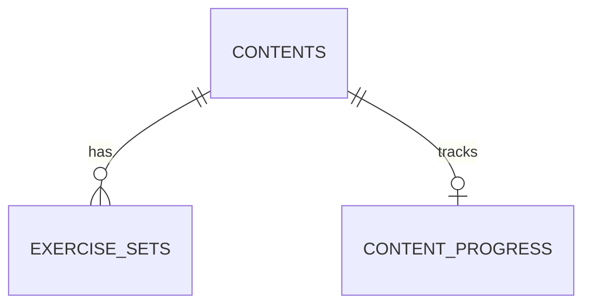

# Convi Database Schema Proposal

> Status: initial schema implemented in `backend/app/models` and managed by Alembic migrations.

## Core Model

For the first version, a `content` row represents one learnable item prepared for one practice mode and one specific method.

For example:

```text
content_type: sentence_pattern
practice_mode: structured_drill
practice_method: substitution
content: I'd like to {place}.
cefr_level: A1
```

If the same pattern is later prepared for transformation practice, it can be added as another content row with `practice_method: transformation`. Some text may be repeated. This keeps the initial model easy to understand and avoids a content-to-activity join table.

## Practice Modes and Methods

`practice_mode` describes the broad kind of speaking practice. `practice_method` describes the specific exercise format used for that content.

| Practice mode | Example methods | Initial scope |
| --- | --- | --- |
| `structured_drill` | `substitution`, `transformation`, `expansion` | `substitution` |
| `vocabulary_phrase_practice` | `active_recall`, `collocation_practice`, `contextual_use` | Later |
| `guided_conversation` | `role_play`, `guided_qa` | Later |

Practice context and register are separate from mode and method. For example, `meeting` or `party` is a context; `formal`, `neutral`, or `informal` is a register. The content's target CEFR level helps the app select and sequence items appropriately.

## Tables

The first version needs **three tables**.

### `contents`

Stores the learnable item and how it should be practiced.

| Field | Purpose |
| --- | --- |
| `id` | UUID primary key |
| `title` | Short display name |
| `content_type` | What the item is: `sentence_pattern`, `expression`, `vocabulary_item`, or `scenario` |
| `practice_mode` | Broad mode, such as `structured_drill` |
| `practice_method` | Specific method, such as `substitution` |
| `content` | The pattern, phrase, word, or scenario prompt |
| `meaning` | Optional explanation or translation |
| `language_code` | Target language, such as `en` |
| `cefr_level` | Optional target level: `A1`, `A2`, `B1`, `B2`, `C1`, or `C2` |
| `context` | Optional situation, such as `meeting`, `presentation`, `daily_conversation`, or `party` |
| `register` | Optional `formal`, `neutral`, or `informal` |
| `source_note` | Optional source title, URL, or note; may be null |
| `status` | For example, `draft` or `active` |
| `created_at`, `updated_at` | Record timestamps |

`content_type`, `practice_mode`, and `practice_method` are controlled values. Define them as enums in the Python application and store them as strings in PostgreSQL. The backend validates that a method is allowed for its mode. This avoids a separate lookup table for static choices and makes it straightforward to add a method. `cefr_level` is also a controlled value; it describes the target level of the content, not the learner's assessed level. Leave it null when the level is not yet known.

### `exercise_sets`

Stores each batch of exercises generated for a content item. One AI call can generate a set of approximately five exercises; the mobile app then presents them one at a time. Keep the generated set so a later review can reuse it without calling the AI again.

| Field | Purpose |
| --- | --- |
| `id` | UUID primary key |
| `content_id` | Foreign key to `contents` |
| `schema_version` | Version of the generated exercise data format |
| `items` | Ordered JSONB array of exercises, validated for the content's mode and method |
| `generation_model` | Optional model identifier |
| `status` | For example, `active` or `archived` |
| `created_at` | Generation timestamp |

For Substitution Drill, each item could contain a cue, expected sentence, and optional hint. Other modes can use different item shapes. The backend validates each shape using `practice_mode`, `practice_method`, and `schema_version`. The API should return an existing active set for review; generate a new set only when none exists or when the user explicitly requests regeneration. Retain archived sets if they may be useful for later review.

### `content_progress`

Stores the current learner's progress for each content item. The first version is for one learner, so it does not need a separate user or learner table.

| Field | Purpose |
| --- | --- |
| `content_id` | Primary key and foreign key to `contents` |
| `status` | `not_started`, `in_progress`, or `practiced` |
| `practice_count` | Number of completed practice sets |
| `last_practiced_at` | Most recent practice timestamp |
| `updated_at` | Progress update timestamp |

`practiced` means the learner completed a practice set; it does not claim that the learner has mastered the content. If no progress row exists, the content has not been started. Add `learner_id` when accounts or multiple learners are introduced.

## Relationships



The mobile app controls the current exercise, retry, and next-step flow. It sends progress updates to the backend, which stores the summary in `content_progress`.

## Source Information

Source tracking does not need a separate table in the first version. The optional `source_note` field can hold a title, URL, or brief reference, or remain null.

If source management becomes a real feature, add a `sources` table and a nullable `source_id` foreign key to `contents` through a database migration. Existing content can keep `source_id` null. If one content item later needs multiple sources, add a join table at that point.

## Deliberately Deferred

- A separate `learners` or `users` table: unnecessary for the initial single-learner version.
- A separate `exercises` table: the first small batch is stored as one ordered JSONB array. Split it into rows if individual exercises need independent querying or analytics.
- Practice session and event history: the initial requirement is whether content is unstarted, in progress, or practiced. Add session history when resume, per-attempt review, or richer analytics are needed.
- Automated material upload and extraction.
- Separate source and content join tables.

This keeps the initial schema to three tables while leaving clear migration paths for accounts, source tracking, detailed history, and additional practice methods.
