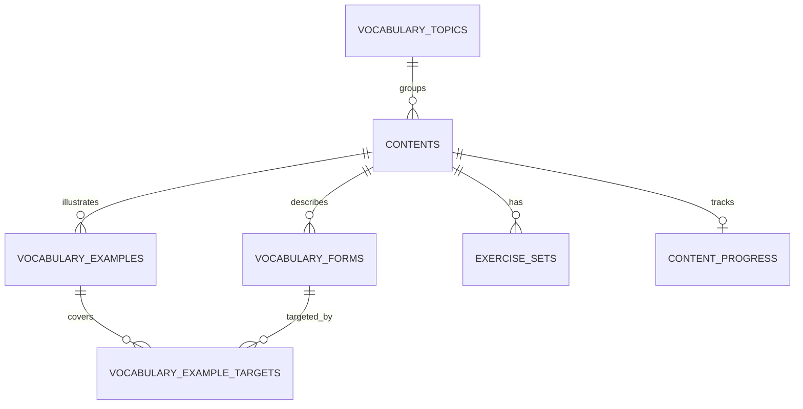

# Convi Database Schema

> Current implementation: seven PostgreSQL tables managed by Alembic. The database contains Finnish vocabulary items and reviewed word-form targets for the first three topics. Example generation and persistence are available through a backend script; the mobile Preparing flow is not connected yet.

## Core Model

Each row in `contents` represents one learnable item. `content_type` identifies the kind of item, while `practice_mode` and `practice_method` describe how it is practiced. At present, `contents` holds vocabulary items; the type field remains available for future content types.

For example, a future sentence-pattern row could look like this:

```text
content_type: sentence_pattern
practice_mode: structured_drill
practice_method: substitution
content: I'd like to {place}.
cefr_level: A1
```

If the same pattern is later prepared for transformation practice, it can be added as another content row with `practice_method: transformation`. Some text may be repeated. This keeps the initial model easy to understand and avoids a content-to-activity join table.

## Practice Modes and Methods

`practice_mode` describes the broad kind of speaking practice. `practice_method` describes the specific exercise format used for that content.

| Practice mode | Example methods | Initial scope |
| --- | --- | --- |
| `structured_drill` | `substitution`, `transformation`, `expansion` | Deferred; no pattern rows currently |
| `vocabulary_phrase_practice` | `active_recall`, `collocation_practice`, `contextual_use` | Current vocabulary rows use `contextual_use`; exercise flow is still evolving |
| `guided_conversation` | `role_play`, `guided_qa` | Later |

Practice context and register are separate from mode and method. For example, `meeting` or `party` is a context; `formal`, `neutral`, or `informal` is a register. The content's target CEFR level helps the app select and sequence items appropriately.

## Tables

The current schema has seven tables: `contents`, `vocabulary_topics`, `vocabulary_forms`, `vocabulary_examples`, `vocabulary_example_targets`, `exercise_sets`, and `content_progress`.

### `contents`

Stores the learnable item and how it should be practiced.

| Field | Purpose |
| --- | --- |
| `id` | UUID primary key |
| `content_type` | What the item is: `sentence_pattern`, `expression`, `vocabulary_item`, or `scenario` |
| `practice_mode` | Broad mode, such as `structured_drill` |
| `practice_method` | Specific method, such as `substitution` |
| `content` | The pattern, phrase, word, or scenario prompt |
| `meaning` | Optional explanation or translation |
| `language_code` | Language of the learning content, such as `fi` |
| `meaning_language_code` | Language used by `meaning` (defaults to `en`) |
| `topic_id` | Vocabulary topic; required for `vocabulary_item` rows |
| `topic_order` | Position of this vocabulary item within its topic, starting at 1; null together with `topic_id` for other content types |
| `cefr_level` | Optional target level: `A1`, `A2`, `B1`, `B2`, `C1`, or `C2` |
| `context` | Optional situation, such as `meeting`, `presentation`, `daily_conversation`, or `party` |
| `register` | Optional `formal`, `neutral`, or `informal` |
| `source_note` | Optional source title, URL, or note; may be null |
| `status` | For example, `draft` or `active` |
| `created_at`, `updated_at` | Record timestamps |

There is no separate `title` field. The app can display `content` directly as the name of a pattern or phrase, avoiding a second manually maintained label.

### `vocabulary_topics`

Stores the ordered bilingual vocabulary topic list (`slug`, English and Finnish names, and `sort_order`). A topic can contain many content rows. The schema keeps meanings optional; the current 949-word import leaves them blank and sets `meaning_language_code` to `en` for later completion.

`content_type`, `practice_mode`, and `practice_method` are represented by Python enums and stored as strings in PostgreSQL. The database currently enforces that vocabulary rows have both a topic and an in-topic position, and that those two fields are either both null or both populated. The API does not yet validate allowed mode/method combinations. `cefr_level` describes the target level of the content, not the learner's assessed level; leave it null when the level is not known.

### `vocabulary_forms`

Stores reviewed forms and usage targets linked to a vocabulary item. A row can represent an inflected form, an invariant item, a related directional form, or a case/usage pattern such as a postposition taking a genitive or partitive complement. This distinction lets later coverage calculations count only the target types they intend to measure.

| Field | Purpose |
| --- | --- |
| `id` | UUID primary key |
| `content_id` | Vocabulary item in `contents` |
| `form` | Form or compact usage target |
| `grammatical_label` | Case/number label or target kind |
| `target_type` | `inflected_form`, `invariant`, `related_form`, or `governed_pattern` |
| `display_order` | Order of the target within its vocabulary item |
| `notes` | Usage or grammar note |
| `review_status` | Review state; imported pilot rows are `reviewed` |
| `source_note` | Source document for the reviewed pilot |
| `created_at` | Record creation time |

The first import contains 232 targets covering 93 vocabulary items across the first three topics. It is idempotently maintained by `scripts.import_vocabulary_forms`. The existing contents API does not yet return these records.

### `vocabulary_examples`

Stores generated Finnish sentences and English translations. `finnish_sentence` is the natural spoken version; `written_finnish_sentence` stores its standard written counterpart. If register does not change the sentence, both fields contain the same text. Sentences are deduplicated per vocabulary item using normalized spoken Finnish. The row records difficulty, generation model, prompt version, and sentence-level validation status.

| Field | Purpose |
| --- | --- |
| `content_id` | Vocabulary item illustrated by the sentence |
| `finnish_sentence` | Natural spoken Finnish example |
| `written_finnish_sentence` | Standard written counterpart; identical when no useful difference applies |
| `normalized_sentence` | Case- and punctuation-normalized spoken version used for uniqueness |
| `english_translation` | Translation of the example |
| `difficulty` | `A1` or `A2` |
| `validation_status` | `auto_valid`, `needs_review`, `human_approved`, or `rejected` |
| `validation_notes` | Automated validation or review notes |
| `generation_model`, `prompt_version` | Generation provenance |

### `vocabulary_example_targets`

Associates an example with one or more targets in `vocabulary_forms`. `primary` identifies the form the example was generated to teach; `reinforcement` can record other forms the same sentence practices. Coverage counts only valid `primary` links. A target link has its own validation state because a sentence may be valid for one target but still require review for another. Previous examples are retained with identical spoken/written text and marked for review or regeneration under the paired-register format.

### `GET /api/v1/contents`

Returns active content filtered by target language, with optional mode, method, and level filters. Each response includes `topic_order` and a nested `topic` object containing the topic ID, slug, English and Finnish names, and topic sort order. Results are ordered by topic, then by position within that topic; content without a topic follows.

### `exercise_sets`

Stores a batch of exercises associated with a content item. This table exists in the schema; generation, validation, and review APIs are not implemented yet.

| Field | Purpose |
| --- | --- |
| `id` | UUID primary key |
| `content_id` | Foreign key to `contents` |
| `schema_version` | Version of the generated exercise data format |
| `items` | Ordered JSONB array of exercises |
| `generation_model` | Optional model identifier |
| `status` | For example, `active` or `archived` |
| `created_at` | Generation timestamp |

Exercise item shapes and their validation rules remain to be designed when pattern drills are introduced.

### `content_progress`

Stores the current learner's progress for each content item. The first version is for one learner, so it does not need a separate user or learner table.

| Field | Purpose |
| --- | --- |
| `content_id` | Primary key and foreign key to `contents` |
| `status` | `not_started`, `in_progress`, or `practiced` |
| `practice_count` | Number of completed practice sets |
| `last_practiced_at` | Most recent practice timestamp |
| `updated_at` | Progress update timestamp |

`practiced` means the learner completed a practice set; it does not claim that the learner has mastered the content. If no progress row exists, the content has not been started. Add `learner_id` when accounts or multiple learners are introduced.

## Relationships



The progress table supports one learner for now. Progress APIs and multi-learner support remain future work.

## Source Information

Source tracking does not need a separate table in the first version. The optional `source_note` field can hold a title, URL, or brief reference, or remain null.

If source management becomes a real feature, add a `sources` table and a nullable `source_id` foreign key to `contents` through a database migration. Existing content can keep `source_id` null. If one content item later needs multiple sources, add a join table at that point.

## Deliberately Deferred

- A separate `learners` or `users` table: unnecessary for the initial single-learner version.
- A separate `exercises` table: the first small batch is stored as one ordered JSONB array. Split it into rows if individual exercises need independent querying or analytics.
- Practice session and event history: the initial requirement is whether content is unstarted, in progress, or practiced. Add session history when resume, per-attempt review, or richer analytics are needed.
- Automated material upload and extraction.
- Separate source and content join tables.

This keeps the current schema small while leaving migration paths for accounts, source tracking, detailed history, and additional practice methods.
